

  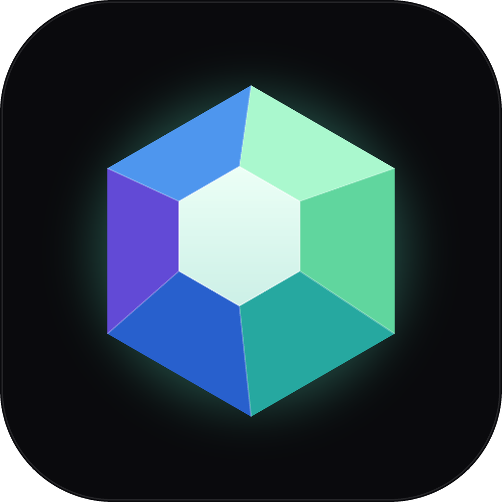

<h1 align="center">Tavo</h1>

  A modern media player for Windows — your videos and music, live TV, internet radio and web videos, in one calm, glassy app.

  <a href="https://github.com/Manoj-lab777/TAVO/releases/latest/download/Tavo-Setup-1.0.0.exe"><b>⬇ Download Tavo 1.0.0 for Windows</b></a>
  &nbsp;·&nbsp;
  <a href="https://github.com/Manoj-lab777/TAVO/releases/latest">All releases</a>

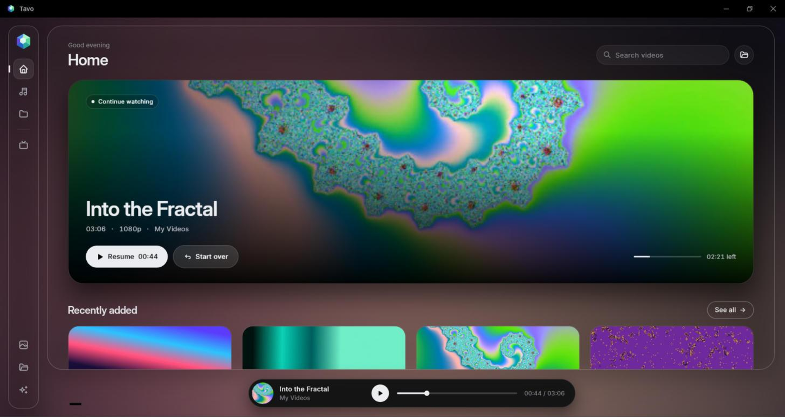

## Watch the trailer

[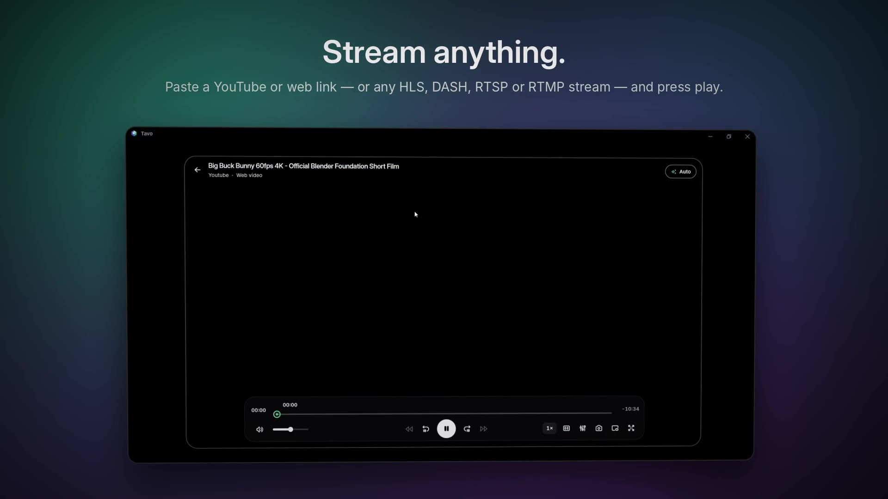](https://github.com/Manoj-lab777/TAVO/releases/download/v1.0.0/Tavo-Trailer.mp4)

70 seconds · every feature · <a href="https://github.com/Manoj-lab777/TAVO/releases/download/v1.0.0/Tavo-Trailer.mp4">download the trailer (MP4)</a>

## Features

- **Plays almost anything** — powered by mpv / FFmpeg, with hardware decoding.
- **Your library** — newest 300 videos and songs from your folders, thumbnails, *Continue watching*.
- **Music player** — queue, shuffle, repeat and synced `.lrc` lyrics.
- **Sound** — booster up to 3×, Voice / Clear / Night modes, 10-band EQ, per-video sound sync.
- **Player** — subtitles, audio tracks, speed, screen fit (*Auto fill* for cinema-wide videos), timeline preview, picture-in-picture, screenshots.
- **Live TV & radio** — free English & Tamil channels from iptv-org, your own M3U playlist, and internet radio.
- **Stream** — paste any stream link (HLS `.m3u8`, DASH, RTSP, RTMP, http…).
- **Web videos** — play links from YouTube and 1,000+ other sites (via yt-dlp — optional, one-click set-up inside Tavo).
- **Private channels** — a hidden, PIN-locked channel list (press `Ctrl` + `Shift` + `L`).
- **Make it yours** — glass or solid look, accent colours, wallpapers, motion effects, `Ctrl` + `K` command palette.

| Player | Sound | Customise |
|---|---|---|
| 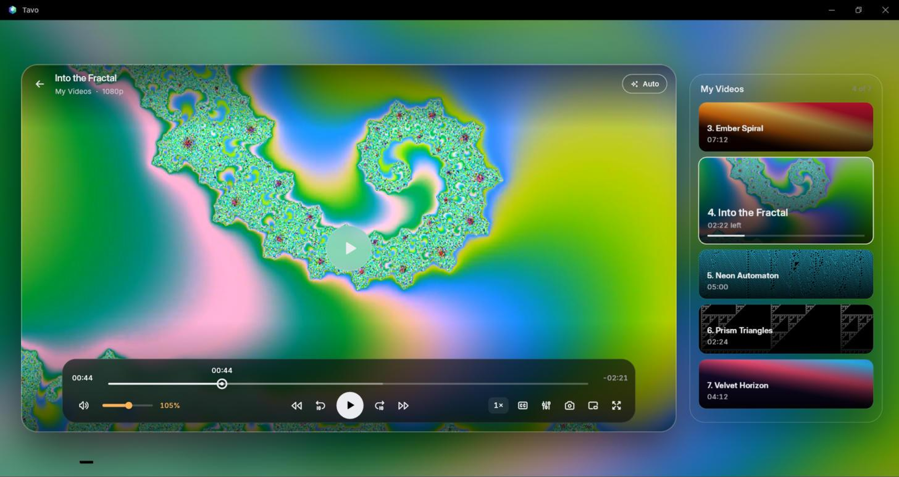 | 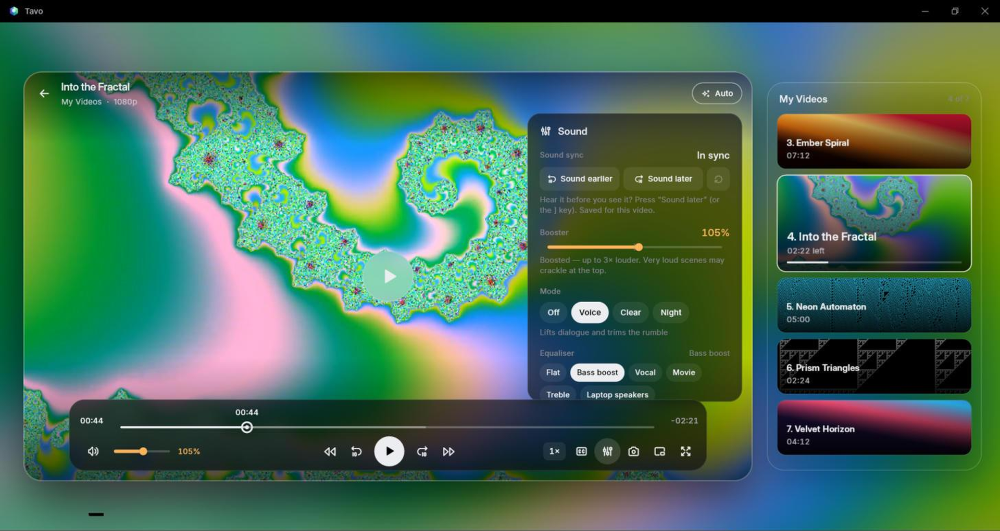 | 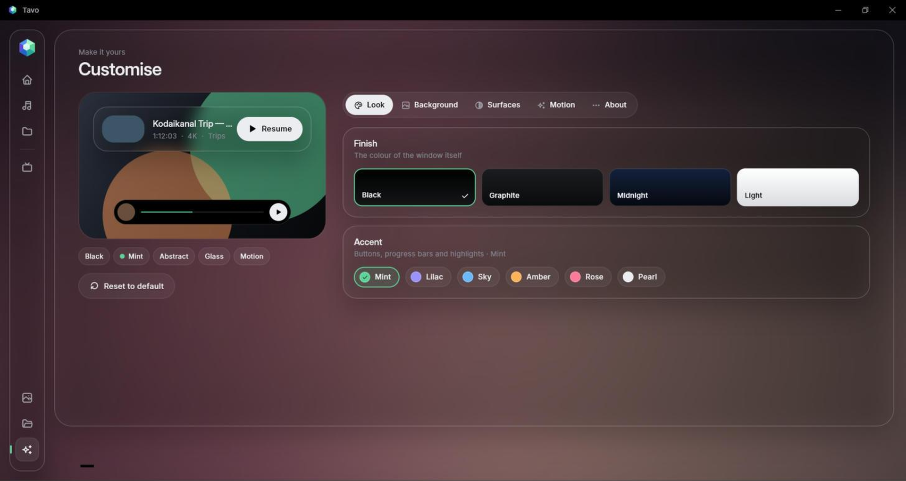 |

### Stream, web videos, Live TV & radio

| Paste a link | YouTube & web videos | Sound panel on a web video |
|---|---|---|
| 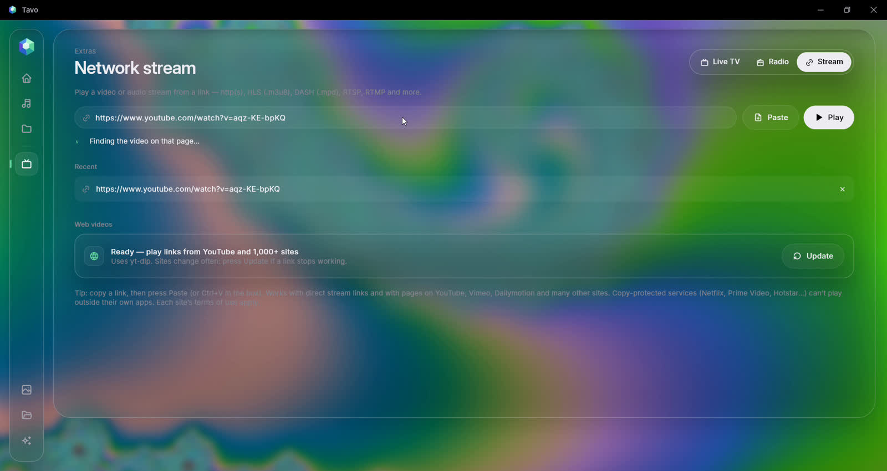 | 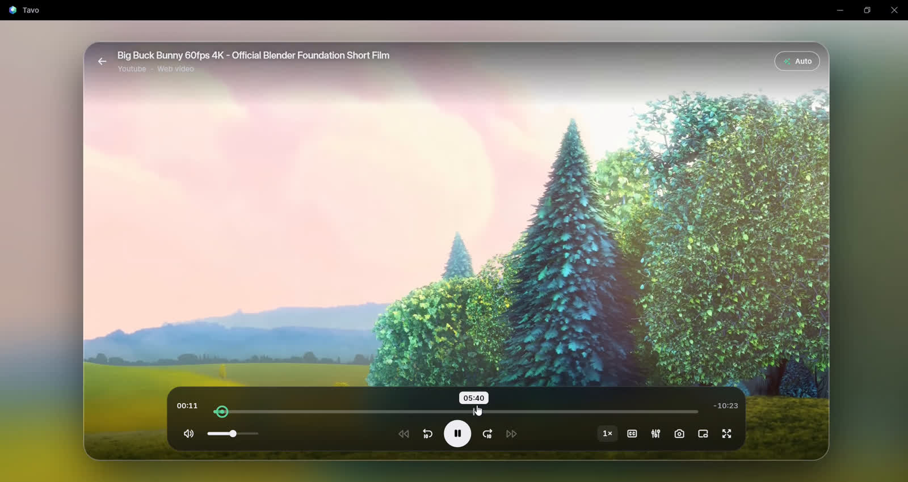 | 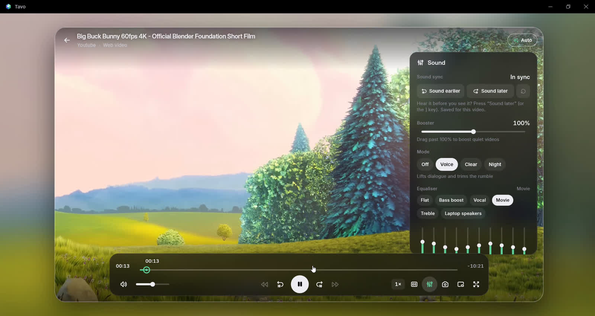 |

| Live TV | Internet radio | Ctrl + K |
|---|---|---|
| 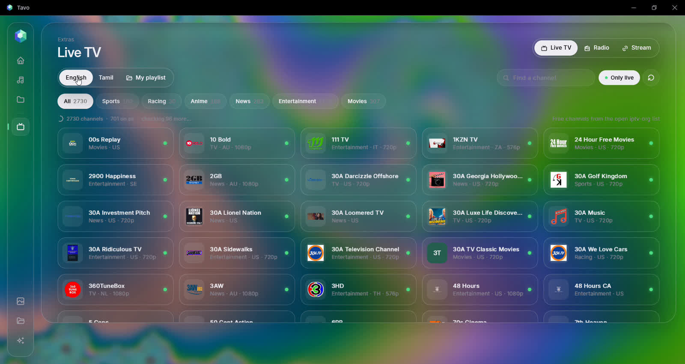 | 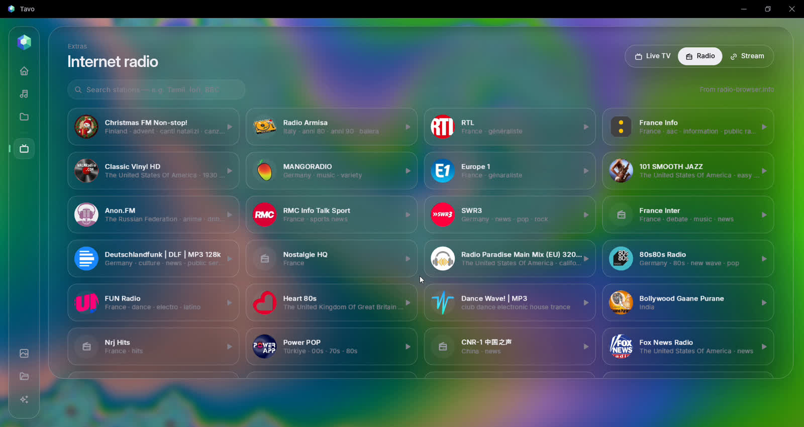 | 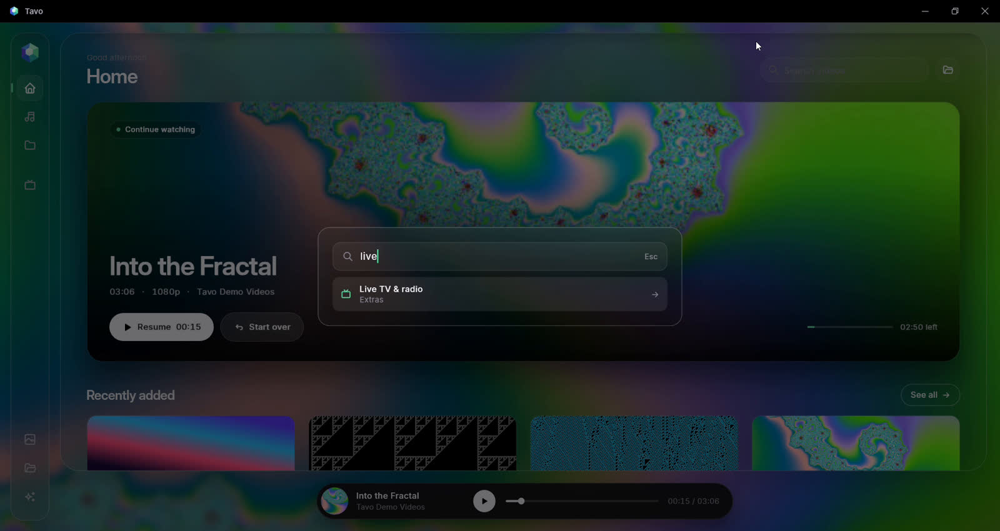 |

Web video shown: *Big Buck Bunny* © Blender Foundation, [peach.blender.org](https://peach.blender.org), licensed under CC BY 3.0.

## Install

1. Download **[Tavo-Setup-1.0.0.exe](https://github.com/Manoj-lab777/TAVO/releases/latest/download/Tavo-Setup-1.0.0.exe)**.
2. If **Edge** says *"Tavo-Setup-1.0.0.exe isn't commonly downloaded"*: open the Downloads panel, click **⋯** next to the file →
   **Keep** → **Show more** → **Keep anyway**. (In Chrome: **Keep** / **Download anyway**.)
3. Run it. No administrator rights needed. Windows 10 or 11, 64-bit.
4. Windows may show **"Windows protected your PC"** the first time. Click **More info → Run anyway**.

> These warnings appear because Tavo is new and its installer isn't code-signed yet — not because anything is wrong.
> You can check your download against the SHA-256 shown on the [release page](https://github.com/Manoj-lab777/TAVO/releases/latest).

To play YouTube and other web videos: open **Live TV → Stream** and press **Set up** once. Tavo downloads two free helpers
(yt-dlp and Deno, about 80 MB) from their official GitHub releases and checks each one against its published checksum.

Tavo is also on the **Microsoft Store** as *TAVO PLAYER* (the Store edition plays ordinary stream links only).

## Handy keys

| Key | Does |
|---|---|
| `Space` | Play / pause |
| `←` `→` | 5 s back / forward |
| `J` `L` | 10 s back / forward |
| `F` | Fullscreen |
| `P` | Picture-in-picture |
| `M` | Mute |
| `C` / `A` | Subtitles / audio track |
| `[` `]` | Sound sync |
| `S` | Screenshot |
| `Ctrl` + `K` | Search & commands |

## Privacy

No account, no ads, no analytics, no tracking. Everything stays on your PC. See [PRIVACY.md](PRIVACY.md).

## Legal

- Tavo © 2026 Manoj. Free to download and use — see [LICENSE.txt](LICENSE.txt).
- Open-source parts (mpv, FFmpeg, Flutter, media_kit, Inter, Tabler Icons …) keep their own licences — see
  [legal/THIRD_PARTY_NOTICES.txt](legal/THIRD_PARTY_NOTICES.txt).
- Tavo does not host or provide any content. You are responsible for what you play and for each site's terms.
  Copy-protected (DRM) services such as Netflix or Prime Video can't be played.

Questions or problems? Open an [issue](https://github.com/Manoj-lab777/TAVO/issues).
